<h1>Hi, I'm Cristian 👋</h1>

<h3>Full-Stack Developer · Automation & AI Workflow Builder · UI/UX-Oriented</h3>

 

  

 

---

 

### 👨‍💻 About Me

I'm a full-stack developer focused on building web applications, automation workflows, and AI-powered integrations.

I enjoy creating practical, user-centered solutions with technologies like React, JavaScript, APIs, webhooks, and automation tools such as n8n. My work combines development, product thinking, and UI/UX to build solutions that are functional, scalable, and easy to use.

- 🎓 Full-Stack Development graduate from **Microverse**
- 🎨 Currently expanding my skills in **UI/UX Design** at **EBAC**
- 🤖 Interested in **AI tools, workflow automation, and smart integrations**
- 🌍 Based in Mexico and open to remote collaboration worldwide

---

 

### 🛠️ Tech Stack

#### Front-End

  
  
  
  
  
  
  
  
  
  
  
  

#### Back-End / Database

  
  
  
  
  
  
  
  
  
  

#### Automation / Tools

  
  
  
  

- APIs  
- Webhooks  
- n8n  
- JSON workflows  
- Figma  
- UI/UX Design  

---

 

### 🚀 What I’m Focused On

- Building web apps with clean, user-friendly interfaces
- Creating automation workflows that reduce repetitive work
- Connecting services through APIs and webhooks
- Exploring AI-powered tools and practical integrations
- Improving product experiences through UI/UX thinking

---

 

### 📈 GitHub Stats

---
